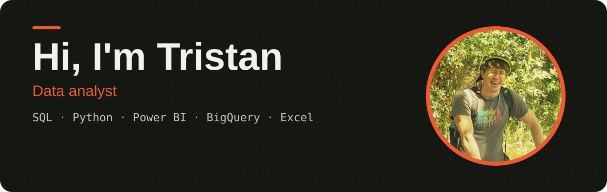
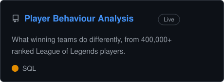
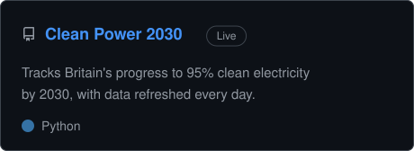
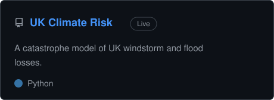
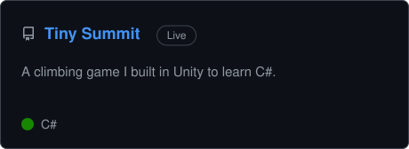
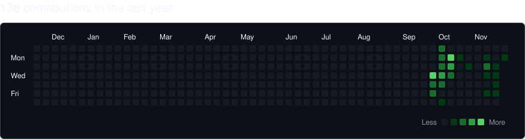

  

<h2>About me</h2>

I'm happiest when I'm working something out from the data, whether that's my training at the gym, the games I play or a problem at work. Every project here started as something I was curious about and wanted to learn how to build.

I'm now looking to get back into working as part of a team. Feel free to get in touch.

<h2> What I'm working on</h2>

  
  
  
  

<h2> Tech stack</h2>

<h2>Contributions</h2>

<h2>Get in touch</h2>

**Email:** [tristanbowdenfreeman@gmail.com](mailto:tristanbowdenfreeman@gmail.com) 
**Phone:** 07496 852532 
**Portfolio:** [tristanbowdenfreeman-maker.github.io/tiny-summit](https://tristanbowdenfreeman-maker.github.io/tiny-summit/)
